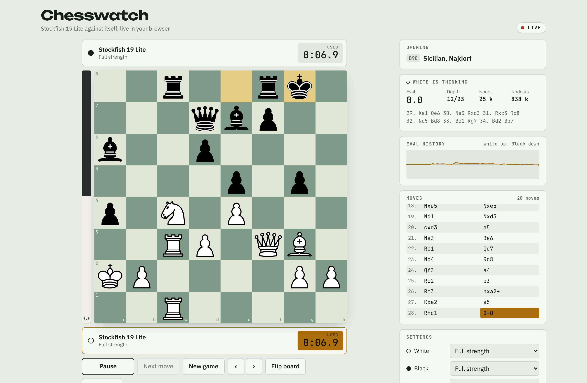
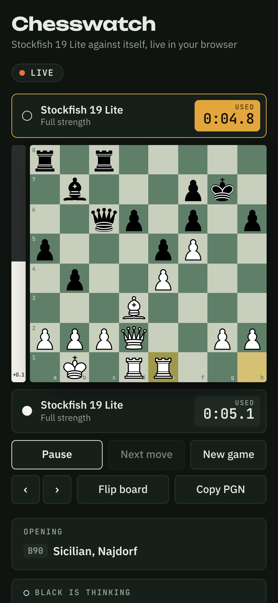

<p align="center">
  
</p>

<p align="center">
  <a href="https://github.com/EnricoZehnder/chesswatch/releases/latest"></a>
  <a href="https://github.com/EnricoZehnder/chesswatch/actions/workflows/build.yml"></a>
  <a href="https://github.com/EnricoZehnder/chesswatch/releases"></a>
  <a href="LICENSE"></a>
</p>

<p align="center">
  
  
  
  
  
</p>

<h3 align="center">
  <a href="https://enricozehnder.github.io/chesswatch/">▶ Play it in your browser</a>
  &nbsp;·&nbsp;
  <a href="https://github.com/EnricoZehnder/chesswatch/releases/latest">⬇ Download the apps</a>
</h3>

<br>

<table>
<tr>
<td width="50%" valign="top">

### Sit back and watch

Two Stockfish 19 engines play each other, live, right on your device. No server, no account, no ads.

Pick the strength for each side, set the clock, and watch the eval bar swing, the search go deeper and the best line change with every move.

Want to follow along slowly? Turn on **step mode** and Stockfish only plays its next move when you click.

</td>
<td width="50%" align="center">

<br><sub>Full strength vs. Elo 2100, 0.3 s per move</sub>
</td>
</tr>
</table>

## ✨ Features

| | |
| --- | --- |
| ♟️ **Engine vs. engine** | Two independent Stockfish 19 instances, compiled to WebAssembly |
| ⏯️ **Step mode** | Stockfish only moves when you click *Next move* or press <kbd>Enter</kbd> |
| 🎚️ **Strength per side** | Full strength or Elo 1320 to 3000, set separately for White and Black |
| ⏱️ **Time controls** | Fixed time per move (0.1 s to 10 s) or a real chess clock: Bullet 1+0, Blitz 3+2, Rapid 10+5 |
| 📖 **Opening book** | 36 openings from the Najdorf to the King's Gambit, so no two games are the same |
| 📈 **Live analysis** | Eval bar, depth, nodes, speed, best line and an eval history graph |
| ⏪ **Review** | Browse back through the game while it keeps playing, then copy the PGN |
| 🏆 **Score** | Wins, draws and losses across games, with automatic next game |
| 🌗 **Light and dark** | Follows your system theme and works on phones |

## 📸 Screenshots

<p align="center">
  
</p>

<p align="center">
  
  &nbsp;
  
</p>

## ⬇️ Download

Everything is on the **[Releases page](https://github.com/EnricoZehnder/chesswatch/releases/latest)**.

| Platform | File | First start |
| --- | --- | --- |
| 🌐 **Web** | nothing to install | [enricozehnder.github.io/chesswatch](https://enricozehnder.github.io/chesswatch/) |
| 🪟 **Windows** | `…-Windows-Setup.exe` or `…-Windows-portable.exe` | *More info* → *Run anyway* |
| 🍎 **macOS** | `…-macOS.dmg` (Intel and Apple Silicon) | Right-click → *Open*. If it says "damaged": `xattr -cr /Applications/Chesswatch.app` |
| 🐧 **Linux** | `…-Linux-x86_64.AppImage` | `chmod +x` it, then run |
| 📱 **iPhone / iPad** | `…-iOS-unsigned.ipa` | Install with [AltStore](https://altstore.io) or [Sideloadly](https://sideloadly.io) |

The apps aren't signed with paid Apple or Microsoft certificates, so your system asks once before opening them.

## ⌨️ Keyboard shortcuts

| Key | Action |
| --- | --- |
| <kbd>Space</kbd> | Start / pause |
| <kbd>Enter</kbd> | Let Stockfish play one move |
| <kbd>←</kbd> <kbd>→</kbd> | Browse moves |
| <kbd>Esc</kbd> | Back to the live position |
| <kbd>F</kbd> | Flip the board |
| <kbd>N</kbd> | New game |

## 🔧 How it works

Chesswatch is a plain static web app with no build step. Each side runs its own [Stockfish 19](https://stockfishchess.org) engine compiled to WebAssembly ([stockfish.js](https://github.com/nmrugg/stockfish.js)) in a web worker and talks to it over UCI. [chess.js](https://github.com/jhlywa/chess.js) checks the rules and detects checkmate, stalemate and draws.

It uses the *lite* build of Stockfish 19: about 1.8 MB with a smaller neural network, so it loads instantly. The full build is about 100 MB. The lite engine is still far stronger than any human.

The desktop apps wrap the same files in [Electron](https://www.electronjs.org), and the iOS app uses [Capacitor](https://capacitorjs.com).

```
web/        the app (HTML, CSS, JS, Stockfish, chess.js)
desktop/    Electron wrapper
ios/        Xcode project (Capacitor)
build/      app icon
docs/       screenshots and images for this page
```

## 🛠️ Development

```bash
# Website: any static server works
python3 -m http.server 8000 --directory web    # → http://localhost:8000

# Desktop app
npm install
npm run desktop          # run it
npm run dist:win         # Windows .exe (also builds on Linux)
npm run dist:linux       # AppImage
npm run dist:mac         # .dmg (macOS only)

# iOS app (macOS + Xcode)
npx cap sync ios         # then open ios/App/App.xcodeproj
```

GitHub Actions builds every app on each push to `main`. To publish a release, bump the version in `package.json`, add a section to [CHANGELOG.md](CHANGELOG.md), then either push a tag like `v1.0.1` or run **Actions → Build apps → Run workflow** with *release* ticked. The website deploys to GitHub Pages from `main`.

## 🙏 Credits

- [Stockfish](https://github.com/official-stockfish/Stockfish) and [stockfish.js](https://github.com/nmrugg/stockfish.js): GPLv3
- [chess.js](https://github.com/jhlywa/chess.js): BSD 2-Clause
- Chess pieces: cburnett, CC BY-SA 3.0 (via [chessground](https://github.com/lichess-org/chessground))

## 📄 License

Chesswatch ships Stockfish, so it is licensed under the [GNU General Public License v3.0](LICENSE).

<p align="center"><sub>Made by <a href="https://github.com/EnricoZehnder">EnricoZehnder</a></sub></p>
