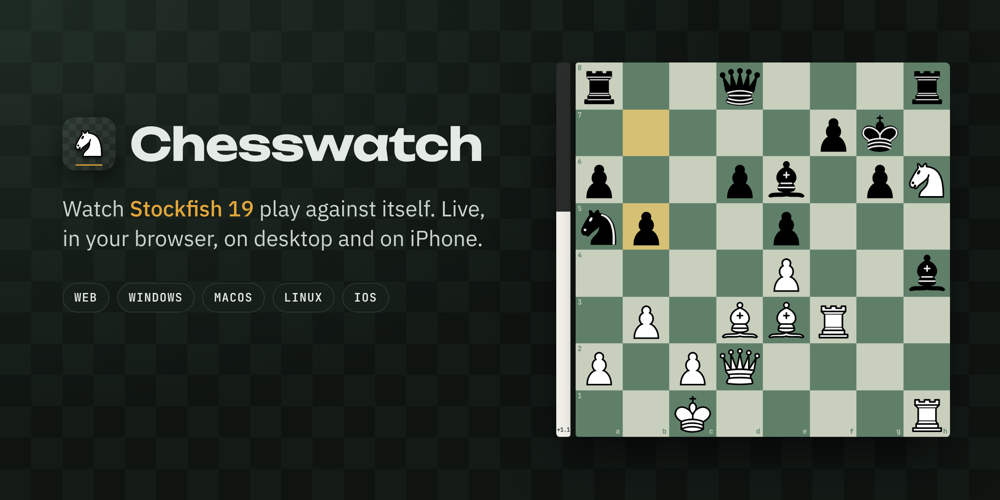
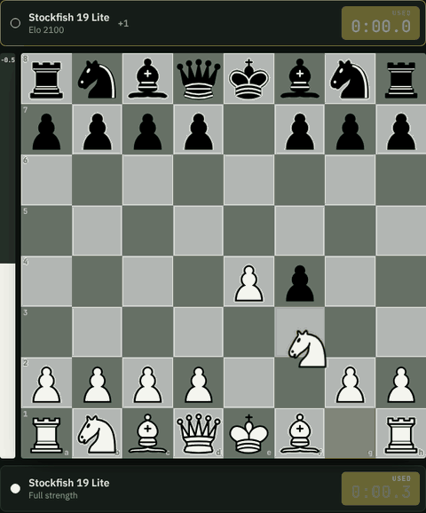
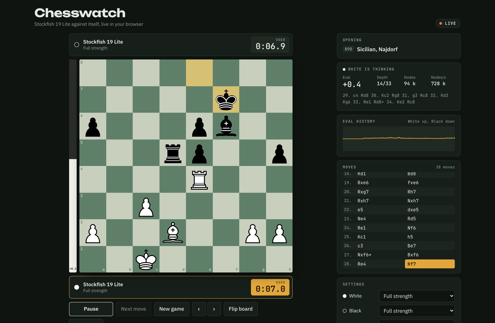

<p align="center">
  
</p>

<p align="center">
  <a href="https://github.com/EnricoZehnder/chesswatch/releases/latest"></a>
  <a href="https://github.com/EnricoZehnder/chesswatch/actions/workflows/build.yml"></a>
  <a href="https://github.com/EnricoZehnder/chesswatch/releases"></a>
  <a href="LICENSE"></a>
</p>

<p align="center">
  
  
  
  
  
</p>

<h3 align="center">
  <a href="https://enricozehnder.github.io/chesswatch/">▶ Play it in your browser</a>
  &nbsp;·&nbsp;
  <a href="https://github.com/EnricoZehnder/chesswatch/releases/latest">⬇ Download the apps</a>
</h3>

<br>

<table>
<tr>
<td width="50%" valign="top">

### Sit back and watch

Two chess engines play each other, live, right on your device. No server, no account, no ads.

Pick any version from **Stockfish 6 (2015) to Stockfish 19**, or **Berserk**, **Obsidian** and **Lozza**, set the strength for each side, and watch the eval bar swing, the search go deeper and the best-move arrow change with every move.

Want to follow along slowly? In **step mode** the engine thinks ahead and only moves when you click. Or pick **You** for one side and play the engine yourself.

</td>
<td width="50%" align="center">

<br><sub>Stockfish 19 Lite vs. Stockfish 8, 0.3 s per move</sub>
</td>
</tr>
</table>

## ✨ Features

| | |
| --- | --- |
| ♟️ **Engine vs. engine** | Two independent engines, compiled to WebAssembly |
| 🕰️ **12 engines** | Stockfish 19, 19 Lite, 18, 17.1, 16, 11, 10, 8 and 6, plus Berserk, Obsidian and Lozza |
| 🧑 **Play yourself** | Pick *You* for a side: drag or click the pieces, on desktop and phone |
| 🎚️ **Strength per side** | Slider from weak to full strength (Elo, skill or level, depending on the engine) |
| ⏯️ **Step mode** | The engine thinks ahead and plays its best move when you click *Next move* or press <kbd>Enter</kbd> |
| 🔊 **Move sounds** | Wooden move, capture, castle and check sounds, on by default |
| ➡️ **Best-move arrow** | See what the engine wants to play while it thinks |
| ⏱️ **Time controls** | Per move (0.1 s to 10 s or your own time), a real chess clock (1+0, 3+2, 10+5), or *Smart*: moves as soon as it's sure |
| 📖 **Openings** | Start from move one, or from one of 36 openings from the Najdorf to the King's Gambit |
| 📈 **Live analysis** | Eval bar, depth, nodes, speed, best line and an eval history graph |
| ⏪ **Review** | Browse back through the game while it keeps playing, then copy the PGN |
| 🏆 **Score** | Wins, draws and losses across games, with captured pieces and material on screen |
| 🌗 **Light and dark** | Follows your system theme and works on phones |

## 📸 Screenshots

<p align="center">
  
</p>

<p align="center">
  
  &nbsp;
  
</p>

## ⬇️ Download

Everything is on the **[Releases page](https://github.com/EnricoZehnder/chesswatch/releases/latest)**.

| Platform | File | First start |
| --- | --- | --- |
| 🌐 **Web** | nothing to install | [enricozehnder.github.io/chesswatch](https://enricozehnder.github.io/chesswatch/) |
| 🪟 **Windows** | `…-Windows-Setup.exe` or `…-Windows-portable.exe` | *More info* → *Run anyway* |
| 🍎 **macOS** | `…-macOS.dmg` (Intel and Apple Silicon) | Right-click → *Open*. If it says "damaged": `xattr -cr /Applications/Chesswatch.app` |
| 🐧 **Linux** | `…-Linux-x86_64.AppImage` | `chmod +x` it, then run |
| 📱 **iPhone / iPad** | `…-iOS-unsigned.ipa` | Install with [AltStore](https://altstore.io) or [Sideloadly](https://sideloadly.io) |

The apps aren't signed with paid Apple or Microsoft certificates, so your system asks once before opening them. The apps download the full Stockfish 19 (95 MB) from the website the first time you pick it; every other engine is built in.

## ♟️ Engines

| Engine | Evaluation | Size | Strength setting |
| --- | --- | --- | --- |
| Stockfish 19 | Neural network | 95 MB | Elo 1320 – max |
| Stockfish 19 Lite | Neural network (small) | 1.8 MB | Elo 1320 – max |
| Stockfish 18 Lite | Neural network (small) | 7 MB | Elo 1320 – max |
| Stockfish 17.1 Lite | Neural network (small) | 7 MB | Elo 1320 – max |
| Stockfish 16 | Neural network | 39 MB | Elo 1320 – max |
| Stockfish 11 | Classic | 3.6 MB | Skill 0 – 20 |
| Stockfish 10 | Classic | 0.4 MB | Skill 0 – 20 |
| Stockfish 8 | Classic | 1 MB | Skill 0 – 20 |
| Stockfish 6 | Classic | 3.2 MB | Skill 0 – 20 |
| [Berserk](https://github.com/jhonnold/berserk) | Neural network | 38 MB | Level 0 – max |
| [Obsidian](https://github.com/gab8192/Obsidian) | Neural network | 29 MB | Level 0 – max |
| [Lozza 11](https://github.com/op12no2/lozza) | Neural network (JavaScript) | 0.7 MB | Level 0 – max |

The Stockfish builds come from [stockfish.js](https://github.com/nmrugg/stockfish.js). Stockfish 1 to 5 never had a browser build, and 12 to 15 only exist as multi-threaded builds, which need server headers GitHub Pages can't send.

Berserk and Obsidian had no browser version, so Chesswatch compiles them to WebAssembly itself: single-threaded, with input that arrives asynchronously so *stop* still works mid-search. The patches and the build script are in [`tools/wasm-engines`](tools/wasm-engines). Engines without their own strength setting get a *level*, which limits how many positions they may search per move.

Closed-source engines such as Komodo Dragon or Torch can't be included, and Leela Chess Zero needs a neural-network runtime that doesn't fit this app yet.

## ⌨️ Keyboard shortcuts

| Key | Action |
| --- | --- |
| <kbd>Space</kbd> | Start / pause |
| <kbd>Enter</kbd> | Let Stockfish play one move |
| <kbd>←</kbd> <kbd>→</kbd> | Browse moves |
| <kbd>Esc</kbd> | Back to the live position |
| <kbd>F</kbd> | Flip the board |
| <kbd>N</kbd> | New game |
| <kbd>M</kbd> | Sound on/off |

## 🔧 How it works

Chesswatch is a plain static web app with no build step. Each side runs its own [Stockfish](https://stockfishchess.org) engine compiled to WebAssembly ([stockfish.js](https://github.com/nmrugg/stockfish.js)) in a web worker and talks to it over UCI. Engines load only when you pick them. [chess.js](https://github.com/jhlywa/chess.js) checks the rules and detects checkmate, stalemate and draws.

The default is Stockfish 19 Lite: 1.8 MB with a smaller neural network, so it loads instantly and is still far stronger than any human. The move sounds are synthesized for Chesswatch (a modelled wooden piece on a wooden board), so they're free to use.

The desktop apps wrap the same files in [Electron](https://www.electronjs.org), and the iOS app uses [Capacitor](https://capacitorjs.com).

```
web/        the app (HTML, CSS, JS, chess.js, sounds)
web/engines every engine, one folder each
tools/      scripts that build Berserk and Obsidian for the browser
desktop/    Electron wrapper
ios/        Xcode project (Capacitor)
build/      app icon
docs/       screenshots and images for this page
```

## 🛠️ Development

```bash
# Website: any static server works
python3 -m http.server 8000 --directory web    # → http://localhost:8000

# Desktop app
npm install
npm run desktop          # run it
npm run dist:win         # Windows .exe (also builds on Linux)
npm run dist:linux       # AppImage
npm run dist:mac         # .dmg (macOS only)

# iOS app (macOS + Xcode)
npx cap sync ios         # then open ios/App/App.xcodeproj
```

GitHub Actions builds every app on each push to `main`. To publish a release, bump the version in `package.json`, add a section to [CHANGELOG.md](CHANGELOG.md), then either push a tag like `v1.0.1` or run **Actions → Build apps → Run workflow** with *release* ticked. The website deploys to GitHub Pages from `main`.

## 🙏 Credits

- [Stockfish](https://github.com/official-stockfish/Stockfish) and [stockfish.js](https://github.com/nmrugg/stockfish.js): GPLv3
- [Berserk](https://github.com/jhonnold/berserk) by Jay Honnold and [Obsidian](https://github.com/gab8192/Obsidian) by Gabriele Lombardo: GPLv3
- [Lozza](https://github.com/op12no2/lozza): free to use
- [chess.js](https://github.com/jhlywa/chess.js): BSD 2-Clause
- Chess pieces: cburnett, CC BY-SA 3.0 (via [chessground](https://github.com/lichess-org/chessground))

## 📄 License

Chesswatch ships Stockfish, Berserk and Obsidian, so it is licensed under the [GNU General Public License v3.0](LICENSE).

<p align="center"><sub>Made by <a href="https://github.com/EnricoZehnder">EnricoZehnder</a></sub></p>
